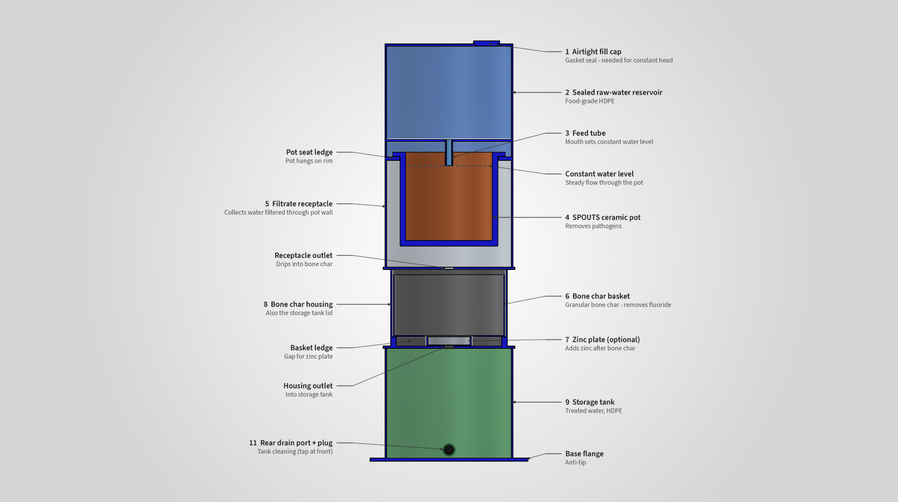
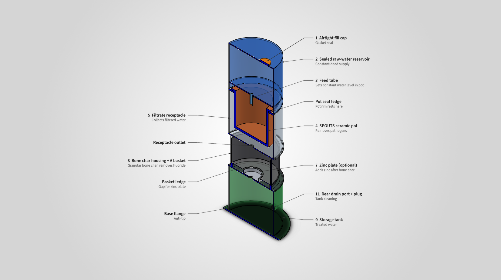

# Re-engineering the Purifaaya Water Filter

Our entry for the Re-Engineering Challenge at the Waterloo Engineering Competition (WEC), Fall 2026. We placed 2nd and won prize money.

The challenge was to take an existing product and re-engineer it for a better or new use. We picked the Purifaaya, a household ceramic water filter made by SPOUTS of Water in Uganda. We kept the part that already works well, the SPOUTS ceramic pot, and designed a new housing around it that:

- filters faster, and keeps the flow steady instead of slowing down as the water level drops
- removes fluoride, which the original filter can't do
- can add zinc to the water as an option

## How it works

Water moves from top to bottom through five stages:

1. **Sealed raw-water reservoir.** You fill it through an airtight cap. A feed tube keeps the water in the ceramic pot at one constant level (the same idea as a Mariotte bottle), so the flow doesn't drop as the reservoir empties.
2. **SPOUTS ceramic pot.** The same pot the Purifaaya uses. It removes about 99.99% of pathogens. We buy it from SPOUTS, so their local factory stays part of the supply chain.
3. **Bone char basket.** A wide, shallow bed of granular bone char removes fluoride without slowing the flow. Households refill it with bags of bone char made by local butchers and abattoirs.
4. **Optional zinc plate.** It sits under the bone char, because the bone char would strip the zinc out if it came first. Households that don't want zinc use a blank plate.
5. **Covered storage tank.** Holds the clean water, with a tap at the front and a drain plug at the back for cleaning.

## Size

About 1300 mm tall and 460 mm wide at the base, and about 22 kg empty with the filter media in (no water).

## Engineering numbers

**Flow.** Flow through the ceramic follows Darcy's law, `Q = K * A * dh / L`, so a steady water level gives a steady flow. We estimate about 7 L/hr, compared to 4.5 to 5 L/hr for the Purifaaya. That's about 40% more water a day (70 L in 10 hours instead of 50 L). We still need to lab-test this.

**Bone char.** Bone char holds about 2 mg of fluoride per gram. At 70 L a day and 3 mg/L of fluoride, that's 210 mg of fluoride a day, so an 8.4 kg charge lasts about 80 days (about 160 days at 1.5 mg/L).

**Zinc.** The zinc is capped at 3 mg/L, Australia's drinking water guideline for taste. A toddler drinking 1 L gets 3 mg, which is under the 7 mg daily safe upper limit. Zinc-releasing filters have already been tested in Benin, and in Kenya the same type of filter raised zinc intake in young children. Each plate costs about UGX 4,000 and is replaced once a year.

## Compared to the Purifaaya

| | Purifaaya | Our design |
|---|---|---|
| Pathogens removed | 99.99% | 99.99% (same ceramic) |
| Fluoride | Not removed | Below 1.5 mg/L (WHO limit) |
| Flow | 4.5 to 5 L/hr, drops as the water level falls | About 7 L/hr, steady |
| Nutrition | None | Optional zinc, about 3 mg/L |
| Salt | Not removed | Not removed |

## Maintenance

- Every 14 days: scrub the ceramic pot. This is the same as the Purifaaya, but the steady flow should mean less clogging.
- About every 80 days: test the fluoride level and refill the bone char at a local refill shop.
- Once a year: replace the zinc plate at the same shop.

## Design decisions

- **No salt removal.** No method that works without fuel or power can do it at this flow rate, and salty water is mostly limited to the crater lake areas of the Rift Valley.
- **Only zinc.** It's the one nutrient with field evidence behind adding it through a filter. Iron causes taste and staining problems, and vitamins don't stay stable in water.
- **Household unit, not a community system.** It compares directly with the Purifaaya, and the bone char refill bags already create a local supply chain.
- **No homemade bone char.** Bone that isn't charred properly makes the water taste and smell bad. Doing it right takes a kiln running for days.
- **No water treatment sachets.** They cost about 10 times more per litre, are imported, and people often don't buy them again.

## Who it helps

- **Families:** protection from fluoride, faster water and optional zinc.
- **SPOUTS:** our design buys their ceramic pots instead of competing with them.
- **Local butchers and abattoirs:** new income from turning waste bones into bone char.
- **The environment:** no fuel needed, and the bone char comes from food waste.

## Documents

- [Presentation](presentation.pdf): the slides we presented to the judges
- [Research report](research-report.pdf): the full write-up with references
- [Metrics and cost model](metrics.xlsx): performance numbers and the cost per litre spreadsheet

## CAD

The model was built in SolidWorks. Open `cad/00_WEC_Filter_Assembly.SLDASM` to see the full assembly, which is made of the 11 part files next to it.
